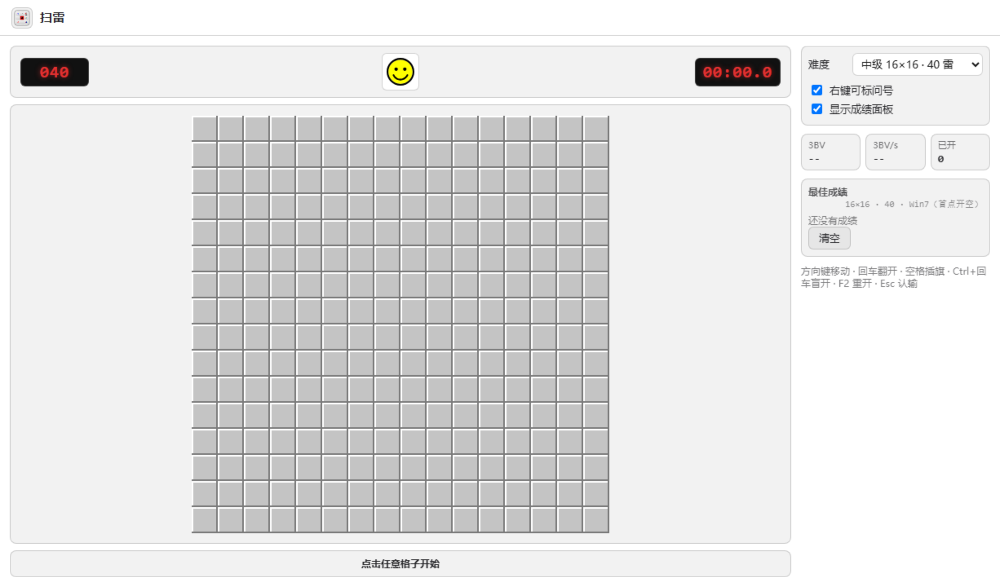
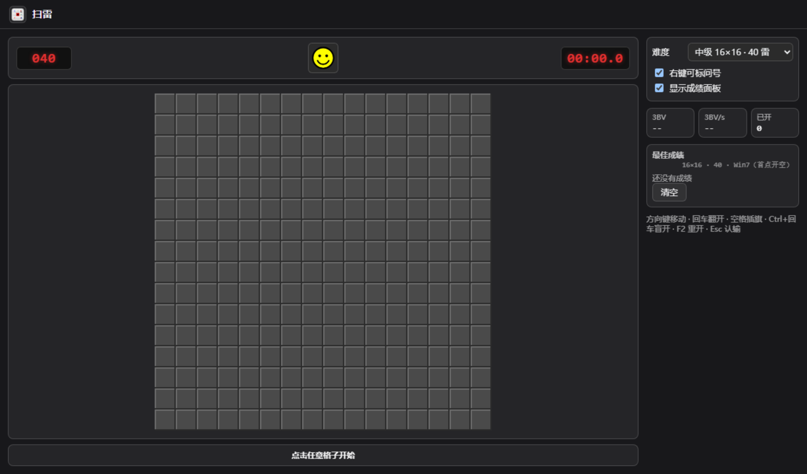
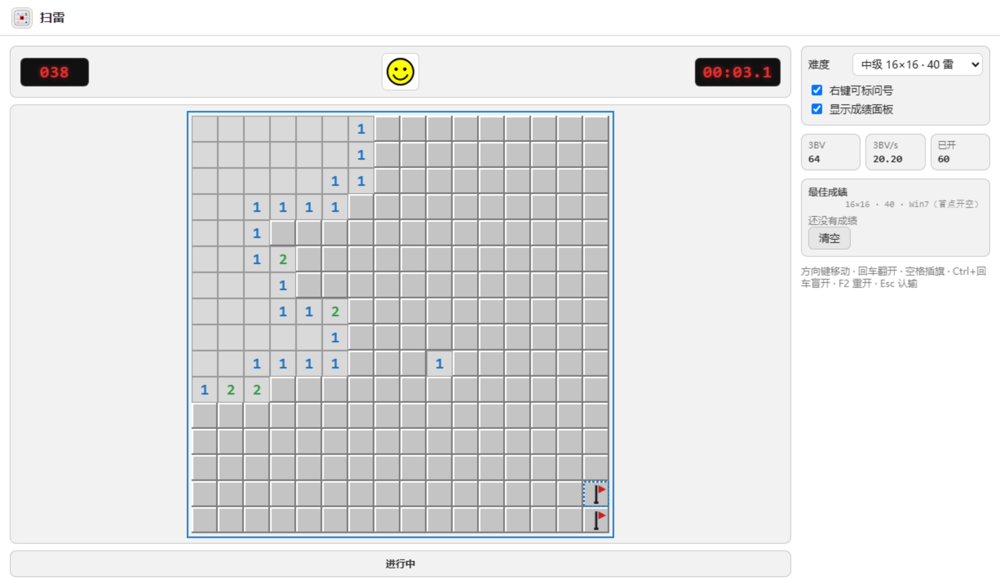
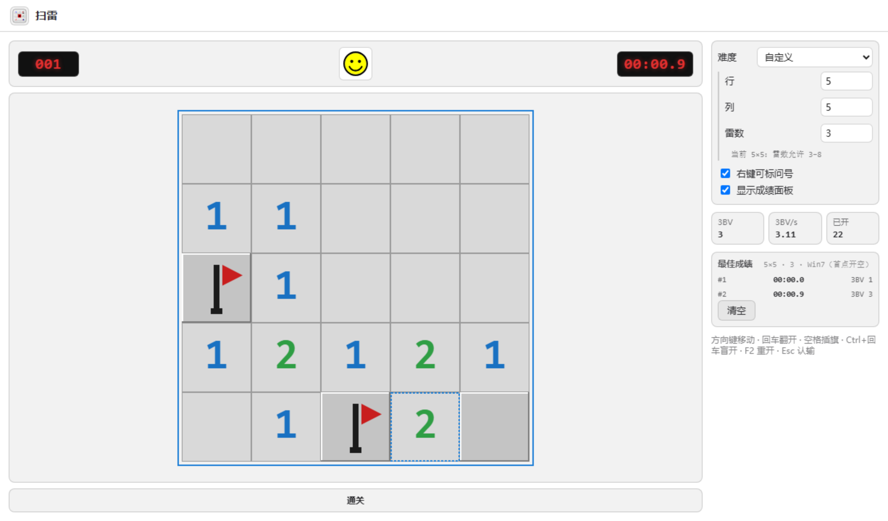
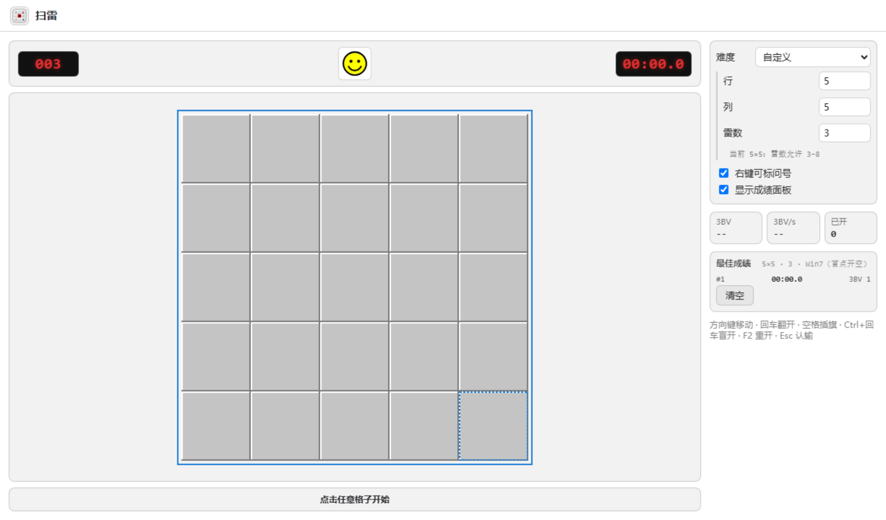
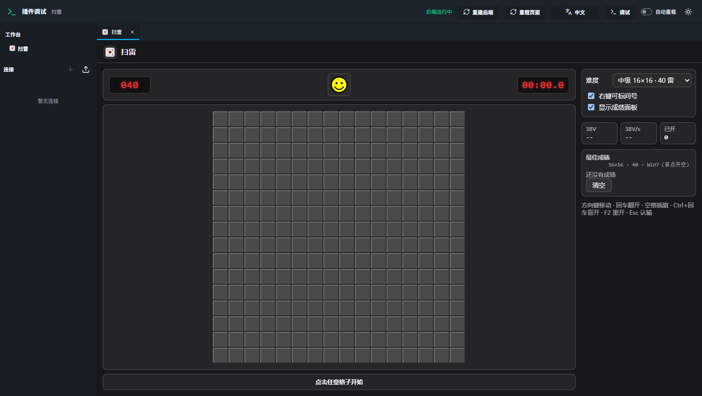

# 扫雷 DataSweep（DBX 插件）

[](https://github.com/vyrnax/dbx-plugin-datasweep/actions/workflows/ci.yml)
[](https://github.com/vyrnax/dbx-plugin-datasweep/releases)

<!-- 两个 badge 在首次 push 与首个 tag 之前会是 404，属正常状态，不是链接写错。 -->

一个装在 [DBX](https://dbxio.com) 里的完整扫雷。左键翻、右键插旗、双击压枪、3BV 与最佳成绩都在。
宿主是数据库客户端——所以它的主要用途是**等慢查询的时候摸鱼**。

- 局面与计时由**原生 Rust 侧车**持有，算法层直接依赖 [`ms_toollib`](https://crates.io/crates/ms_toollib)（MIT）
- 前端是原生 HTML + CSS + Canvas，**零构建、零 npm 依赖**
- **不联网、不读连接、不碰 SQL**：manifest 的 `permissions` 是空的

> 开发规范与架构约定见 [`AGENTS.md`](./AGENTS.md)，实施蓝图见 [`PLAN.md`](./PLAN.md)。

---

## 先看效果

| 浅色 · 中级初始态 | 深色 · 跟随宿主 |
|---|---|
|  |  |

| 进行中（已开 60 格） | 通关并写入成绩 |
|---|---|
|  |  |

自定义尺寸面板，以及插件嵌在宿主里的实际样子：




---

## 为什么值得用

| 你要完成的事 | 扫雷 DataSweep 给你的体验 |
| --- | --- |
| 等查询的间隙放松一下 | 打开工作台就能玩，棋盘自适应铺满可用区域，格子随尺寸自动放大缩小 |
| 认真刷成绩 | 首点保护、压枪、拖拽批量插旗、键盘全套，手感对齐经典扫雷 |
| 想知道自己打得怎么样 | 秒表、剩余雷数、3BV 与 3BV/s 实时显示；成绩按「尺寸 + 雷数 + 首点规则」分别保存本地 Top 10 |
| 不想被看着 | 界面完全跟随宿主的明暗主题与语言；关掉工作台就什么都没有了 |
| 在意隐私 | 不发起任何网络请求，不读取任何宿主数据，成绩与偏好只写本机插件数据目录 |

---

## 核心能力

**玩法**

- 三档预设难度：初级 9×10/10、中级 16×16/40、高级 16×30/99
- 自定义尺寸：行列各 5–50，雷数取格数的 10%–35%。越界输入**自动夹到边界**而不是报错——输入 1 就取下限，超过 35% 就取上限
- 首点保护：Win7 规则，首点必然开空且周围 8 格无雷
- 左键翻格、右键旗 → 问号 → 空循环、左右键同按压枪、按住右键拖拽批量插旗、`Ctrl` + 左键盲开
- 键盘操作：方向键移动、`Enter` 翻开、`Space` 插旗、`Ctrl+Enter` 盲开、`F2` 重开、`Esc` 认输

**面板**

- 秒表、剩余雷数、3BV、3BV/s、已开格数
- 分维度本地最佳成绩 Top 10，可清空
- 右侧栏顺序：状态 → 难度设置 → 统计 → 成绩；选中「自定义」才展开行 / 列 / 雷数，并在雷数下方显示当前尺寸允许的雷数区间

**外观与语言**

- 明暗主题、调色板、圆角、字体、界面语言全部跟随宿主 DBX，切换即时生效，无需重开工作台
- 界面支持简体中文与英语，其余语言自动退回英语

**成绩可信**

- 权威计时与胜负判定都在 Rust 侧车内部闭环，真实雷位从不下发给前端，成绩无法被界面篡改

---

## 安装

**从商店安装**（v0.1.0 审核通过后）：DBX → 插件中心 → 官方商店，搜索「扫雷」或 `DataSweep`。

**从 Release 手动安装**：到 [GitHub Releases](https://github.com/vyrnax/dbx-plugin-datasweep/releases) 下载匹配平台的 `.dbxp`，在 DBX 插件中心选择「从本地安装」。

> Release 里的包是**未签名候选**，用于自测；商店分发的是官方审核并签名后的那份。
> 每个版本由 CI 在对应平台真机构建，覆盖 `windows-x64`、`linux-x64`、`linux-arm64`、`darwin-x64`、`darwin-arm64`。

---

## 数据与隐私

- **不联网**：不声明任何 `host.network` 权限，侧车不发起网络请求、不监听端口、无遥测
- **不读宿主数据**：不读取连接、SQL、schema、剪贴板
- **只写一个文件**：`<插件数据目录>/datasweep.json`，内容是偏好与最佳成绩，明文、不含任何凭据
- **卸载不自动删除**：该文件保留在本机，需要清空可在面板里按「清空」，或自行删除该文件
- **无自动点击 / 机器求解**：只用 `ms_toollib` 做局面生成与 3BV 计算

---

## 已知限制

- **侧车被宿主回收后本局作废**（界面会提示「侧车已重启，本局作废」）。成绩与偏好都在磁盘上，不受影响。这是原生 sidecar 的固有生命周期，不做跨进程局面恢复。
- **单局最大 50×50 = 2500 格**。再大的尺寸对摸鱼场景没意义。
- **无触屏 / 移动端适配**，面向 DBX 桌面宿主。
- **不提供这些功能**（产品边界，不是宿主不支持）：录像播放、机扫 / 自动求解、光学局面识别、在线排行榜、云同步。
- 无猜模式与逐格雷概率着色排在 **0.2.0**。

---

## 开发与验证

```bash
cargo test --manifest-path backend/Cargo.toml          # 侧车单测
node _e2e.mjs ./backend/target/release/dbx-plugin-datasweep.exe   # 协议端到端
python _domcheck.py && python _releasecheck.py          # 前端与发布链路静态闸门
dbx-plugin package . && node _verify.mjs "dist/*.dbxp"  # 本机打包与包结构校验
dbx-plugin dev --port 5190                              # 开发宿主，打开 http://127.0.0.1:5190
```

推 tag 即由 GitHub Actions 在**各平台真机**上构建 5 个 `.dbxp` 并自动挂到 Release。
工具链要求、vendor SDK 的来由、跨平台限制、发布与上架流程，全部写在 [`AGENTS.md`](./AGENTS.md)。

---

## 许可

Apache-2.0，详见 [`LICENSE`](./LICENSE)。

依赖许可：`ms_toollib`（MIT）、`dbx-plugin-sdk`（Apache-2.0，官方 SDK）、`serde` / `serde_json`（MIT / Apache-2.0）。

本插件与 [元扫雷 Metasweeper](https://github.com/eee555/Metasweeper)（GPL-3.0 + 附加商业限制条款）**没有代码衍生关系**，仅通过 crates.io 使用其以 MIT 发布的算法库 `ms_toollib`；界面、图标、文案与实现全部为本仓库原创。
